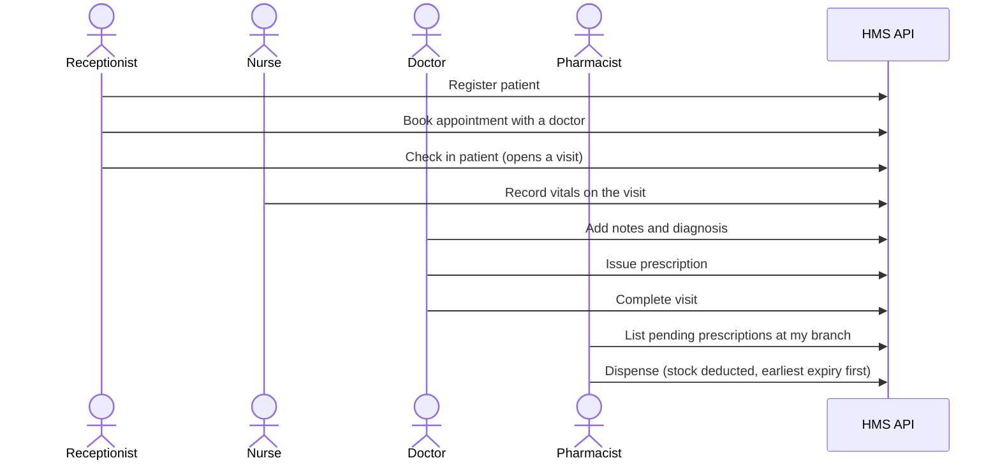

# Hospital Management System

[](https://github.com/MohamedElfares/hospital-management-system/actions/workflows/ci.yml)

A hospital system that connects registration, scheduling, consultations, a multi-branch
pharmacy, customer service and a patient portal, so that each person can do exactly what
their role requires and every access to medical data is traceable. A FastAPI backend with
PostgreSQL, and a React frontend from Phase 2, built in five phases.

The full specification — scope, rules, endpoints and decisions — is in
[`docs/PROJECT_PLAN.md`](docs/PROJECT_PLAN.md).

## Status

**Phase 1, Milestone 1.2 (Identity and access), in progress.** The application runs,
serves its health checks, and has a `users` table with hashed passwords and a
`create-admin` command. Users can sign in, keep their session through a refresh cookie,
sign out, and change their password, and a temporary password must be changed before
anything else. Rate limiting, permissions and staff administration come next in this
milestone; clinical data arrives in the milestones below.

| Milestone | What it adds | State |
|---|---|---|
| 1.1 Foundation | Settings, database layer, error format, request IDs, health checks, tests, CI | **Done** |
| 1.2 Identity and access | Users, login with cookie refresh, permissions, staff administration, first deployment | **In progress** |
| 1.3 Organization, audit, patients | Departments, branches, staff profiles, audit log, patients | Planned |
| 1.4 Scheduling | Appointments, slots, check-in | Planned |
| 1.5 Clinical and prescriptions | Vitals, visits, prescriptions | Planned |
| 1.6 Pharmacy | Medicines, stock batches, FEFO dispensing, reports | Planned |
| 1.7 Release readiness | Workflow test, demo data, security checklist, ADRs | Planned |

Phases 2 to 5 add the staff web app, pharmacy branches, the patient portal, and customer
service and management (plan §2).

There is no public deployment yet; the first one happens in Milestone 1.2.

## What works today

| Endpoint | Purpose |
|---|---|
| `GET /health/live` | The process is running. Touches nothing else, so a sleeping database never makes it fail. |
| `GET /health/ready` | The application can serve requests: it runs `SELECT 1`. Answers `503` in the standard error format when the database is unreachable. |
| `GET /docs` | Interactive API documentation, generated from the code. |
| `POST /api/v1/auth/login` | Sign in with an email and password. Returns a 15-minute access token and sets a 7-day refresh cookie. |
| `POST /api/v1/auth/refresh` | Exchange the refresh cookie for a new access token and a new cookie. |
| `POST /api/v1/auth/logout` | Sign out on this device: its refresh token is revoked and the cookie cleared. |
| `GET /api/v1/auth/me` | The signed-in user's account, including whether a password change is due. |
| `POST /api/v1/auth/change-password` | Change the password with the current one. Ends the sessions on every other device. |

Behind those endpoints:

- **Validated settings.** A wrong database driver, a short JWT secret or an unknown
  timezone stops the application at startup instead of failing later.
- **One error format** for every failure, including the ones FastAPI and Starlette raise
  themselves: `{"error": {"code", "message", "details", "request_id"}}`.
- **A request ID** on every request, returned in the `X-Request-ID` header, included in
  error bodies, and written in one log line per request with the method, path, status and
  duration — so a failure a user reports can be found in the logs.
- **A database layer** that gives every future table a UUID primary key and timezone-aware
  UTC timestamps, with Alembic wired to the models.
- **User accounts.** A `users` table whose rules hold even for writes that skip the
  application: emails are unique and stored lowercase, and roles are limited to the eight
  defined roles. Passwords are stored only as Argon2id hashes.
- **The first Admin.** `python -m app.cli create-admin` creates the first account on an
  empty database. The password is typed twice at a hidden prompt, never passed as an
  argument, and must be 12 to 128 characters. The command refuses when an active Admin
  already exists.
- **Sessions that can be ended.** The access token is a short-lived JWT the web app will
  keep in memory only. The refresh token travels only in an `HttpOnly`, `SameSite=Strict`
  cookie, the database stores only its hash, and it works once: every refresh replaces
  it, without ever extending the 7 days that began at sign-in. If a replaced token comes
  back, a copy exists, so every session of that user is ended
  ([ADR-0004](docs/adr/0004-tokens-and-rate-limiting.md)).
- **One answer for every failed sign-in.** A wrong email, a wrong password and a
  deactivated account get the same `401` in roughly the same time, so the API never
  reveals which accounts exist.
- **A forced password change.** While an account still has a temporary password, every
  endpoint except the current-user, refresh, sign-out and change-password routes answers
  `403 PASSWORD_CHANGE_REQUIRED`. The check is on by default, so a new endpoint can't
  forget it.

## The workflow this is being built toward



None of these endpoints exist yet; they are built in Milestones 1.3 to 1.6.

## Architecture

A modular monolith: one FastAPI application, split into modules that each own their
tables and rules, deployed as a single container (plan §9).

| Layer | File | Responsibility |
|---|---|---|
| Router | `router.py` | HTTP only: validate input, call one service, declare the response model |
| Schemas | `schemas.py` | Pydantic request and response models |
| Service | `service.py` | Business rules, record-level authorization, state transitions, the transaction boundary |
| Repository | `repository.py` | Queries, and nothing else |
| Models | `models.py` | SQLAlchemy tables and constraints |

Cross-cutting infrastructure lives in `app/core/` (settings, errors, logging) and
`app/db/` (base model, session), and neither imports from the business modules.

The decisions behind this are recorded as ADRs in [`docs/adr/`](docs/adr/):
[0001 — a modular monolith instead of microservices](docs/adr/0001-modular-monolith.md),
[0002 — synchronous SQLAlchemy instead of async](docs/adr/0002-synchronous-sqlalchemy.md),
and
[0004 — short-lived access tokens, rotating refresh tokens in a cookie, and in-memory rate limiting](docs/adr/0004-tokens-and-rate-limiting.md).

Three rules shape most of the design:

- **Deny by default.** Every route is Public, Authenticated, or protected by a permission,
  and record-level checks live in services. A record outside your scope returns `404`, not
  `403`, so IDs cannot be probed.
- **The database enforces what must survive concurrency:** partial unique indexes for
  double-booking, `CHECK` constraints for stock, and row locks for dispensing.
- **Services never raise `HTTPException`.** They raise domain errors, and handlers turn
  those into the one response format.

## Tech stack

| Concern | Choice |
|---|---|
| Language | Python 3.13 |
| Web framework | FastAPI 0.141 with Pydantic 2 |
| Database | PostgreSQL 17, SQLAlchemy 2 with psycopg 3 |
| Migrations | Alembic |
| Authentication | PyJWT for HS256 access tokens, pwdlib with Argon2id for passwords |
| Packaging | uv, with a committed lockfile |
| Lint and format | Ruff, also run by pre-commit |
| Tests | pytest with pytest-cov, against a real PostgreSQL database |
| CI | GitHub Actions |
| Planned | React 19 and TypeScript (Phase 2), Docker image and Render plus Neon hosting (Milestone 1.2) |

## Running it locally

**You need** [Docker](https://www.docker.com/), [uv](https://docs.astral.sh/uv/), and Git.

```bash
git clone https://github.com/MohamedElfares/hospital-management-system.git
cd hospital-management-system

# 1. Start PostgreSQL 17
docker compose up -d db

# 2. Create the database the tests use (once)
docker compose exec db createdb -U hms hms_test

# 3. Configure the backend
cd backend
cp .env.example .env
uv run python -c "import secrets; print(secrets.token_hex(32))"   # paste into JWT_SECRET_KEY

# 4. Install dependencies and create the tables
uv sync
uv run alembic upgrade head

# 5. Create the first Admin (asks for the password twice, hidden)
uv run python -m app.cli create-admin --email admin@hospital.test --full-name "Ada Admin"

# 6. Run the API
uv run fastapi dev app/main.py
```

Then open <http://localhost:8000/docs>, click **Authorize**, and sign in with the Admin's
email as the username and the password you chose. The protected endpoints then send the
access token for you.

`.env.example` lists every setting with a safe development value. Only `JWT_SECRET_KEY`
has to be replaced; the database URLs match the Compose file.

### Tests

```bash
cd backend
uv run pytest                 # 245 tests
uv run pytest --cov=app       # with coverage; CI requires at least 80%
```

Tests run against the `hms_test` database, inside a transaction that is rolled back after
every test, so they leave nothing behind and never touch development data.
[`backend/tests/README.md`](backend/tests/README.md) explains the fixtures.

### Checks that CI also runs

```bash
cd backend
uv run ruff check .           # lint, including docstring and import rules
uv run ruff format --check .  # formatting
uv run alembic upgrade head   # apply migrations
uv run alembic check          # fail if the models and migrations disagree
```

## Repository layout

```text
backend/
├── app/
│   ├── main.py            # create_app(): logging, error handlers, middleware, routers
│   ├── cli.py             # maintenance commands: create-admin
│   ├── api/               # health checks, the /api/v1 router, the signed-in-user dependencies
│   ├── core/              # config, errors, logging, permissions (roles), security (passwords, tokens, cookies)
│   ├── db/                # base.py (declarative base and mixins), session.py
│   └── modules/
│       ├── auth/          # sign-in, refresh, sign-out, password change: models to router
│       └── users/         # models, schemas, repository, service
├── migrations/            # Alembic
└── tests/                 # pytest suite and its fixtures
docs/PROJECT_PLAN.md       # the specification this follows
tutorial/                  # one HTML page per finished stage of the build
.github/workflows/ci.yml   # lint, migrations, tests with coverage
docker-compose.yml         # PostgreSQL 17 for development
```

## Documentation

- [`docs/PROJECT_PLAN.md`](docs/PROJECT_PLAN.md) — scope, domain model, authorization
  model, API catalogue, testing strategy and roadmap.
- [`tutorial/`](tutorial/) — a page per finished stage, written so the build can be
  followed step by step: open any `.html` file in a browser.
- [`backend/tests/README.md`](backend/tests/README.md) — how the test suite isolates
  itself.
- Every module, class, function and test carries a docstring, and every import has a
  one-line comment explaining what it is and why the file uses it.

## Known limitations

- **No permissions yet.** Users can sign in, but every signed-in user can reach the same
  endpoints: permission checks and staff administration arrive later in Milestone 1.2,
  and the audit log in 1.3. Only the first Admin can be created so far.
- **No rate limiting yet.** Sign-in, and the current-password check when changing a
  password, can be retried without limit until rate limiting arrives later in Milestone
  1.2.
- **An access token outlives sign-out.** It can't be revoked, so it keeps working for up
  to 15 minutes after a sign-out or a password change; the refresh token stops at once.
- **Not deployed.** The Docker image and the first Render deployment come with Milestone
  1.2, together with a live demo link and demo accounts.
- **No frontend.** Phase 2 adds the React application; until then the API documentation at
  `/docs` is the interface.
- **The database only holds generated data.** No real patient information is ever used.

## Who built what

This is a learning project, and the split is deliberate.

| Written by | Parts |
|---|---|
| **[@MohamedElfares](https://github.com/MohamedElfares)** | All backend code and tests: settings, the database layer and migrations, the error format, the request-ID middleware, the health checks, the application factory, the users model, schema, repository and service, password hashing, the `create-admin` command, the auth module (access and refresh tokens, sign-in, refresh with reuse detection, sign-out, the current user, changing the password, and the forced-password-change gate), and the tests in `backend/tests/` |
| **Claude Code** | CI/CD and Docker configuration, the documentation (docstrings, import comments, this README, the ADRs written up from the decisions as explained to it, the tutorial pages), and code review |

Every backend change was written by hand and reviewed against the plan; the rules that
govern that collaboration are in [`CLAUDE.md`](CLAUDE.md).
